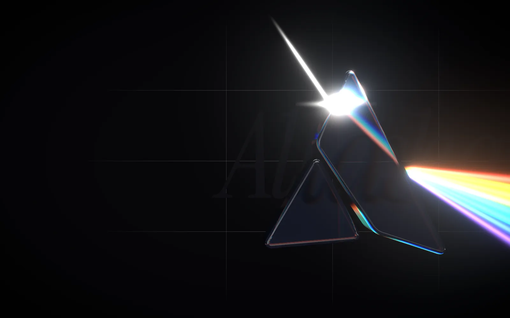

# Allaska, site institucional ("Prisma")

Site da [Allaska](https://allaska.com.br), agência de software para negócios locais. No ar em **[allaska.com.br](https://allaska.com.br)**.



## Ideia

A marca vira a cena. O "A" do logo é um prisma de vidro em 3D. Um feixe de luz branca entra nele e sai como um espectro de 6 cores, e cada cor é uma das 6 soluções da agência (site, prospecção, conteúdo, remarketing, chatbot e proposta com follow-up). Conforme a pessoa rola a página, a câmera e a luz percorrem o espectro e cada raio abre a sua seção.

## Como foi feito

- **Vidro de verdade em tempo real:** React Three Fiber com `MeshTransmissionMaterial` (refração e aberração cromática) e pós-processamento.
- **Rolagem conduzindo a cena:** GSAP + ScrollTrigger + Lenis. O estado da cena (`src/lib/stage.ts`) é um objeto único que a rolagem escreve e o render lê, sem re-render do React a cada quadro.
- **Celular projetado à parte, não só encolhido:**
  - o prisma fica numa camada fixa que encaixa em 3 pontos da página;
  - a seção de soluções fica presa e mostra um raio por vez, com snap direcional;
  - a cor da barra do navegador (`theme-color`) muda com o raio;
  - o prisma responde a giroscópio, arraste com mola e toque;
  - feixes de luz em Canvas 2D passam ao fundo e acompanham a velocidade da rolagem.
- **Degrada sem quebrar:**
  - aparelho fraco, `prefers-reduced-motion` ou WebGL indisponível ficam com imagem estática do prisma (gerada pela própria cena com `?capture=desktop|portrait|og`);
  - se o 3D não acender em 10 s, a imagem entra no lugar.
- **Conteúdo separado do código:** soluções e projetos em `src/data/*.ts`.

## Stack

React 19 · TypeScript · Vite · Tailwind CSS v4 · Three.js · React Three Fiber + drei + postprocessing · GSAP + ScrollTrigger · Lenis · Netlify

## Rodar

```bash
npm install
npm run dev          # http://localhost:5187
npm run dev:https    # HTTPS na rede local, necessário para testar o giroscópio no celular
npm run build        # gera dist/ para publicar
```

Parâmetros úteis na URL: `?lite` força a versão de celular no computador e `?full` força o 3D.

Feito por [Diego de Moraes](https://www.linkedin.com/in/euudm).
